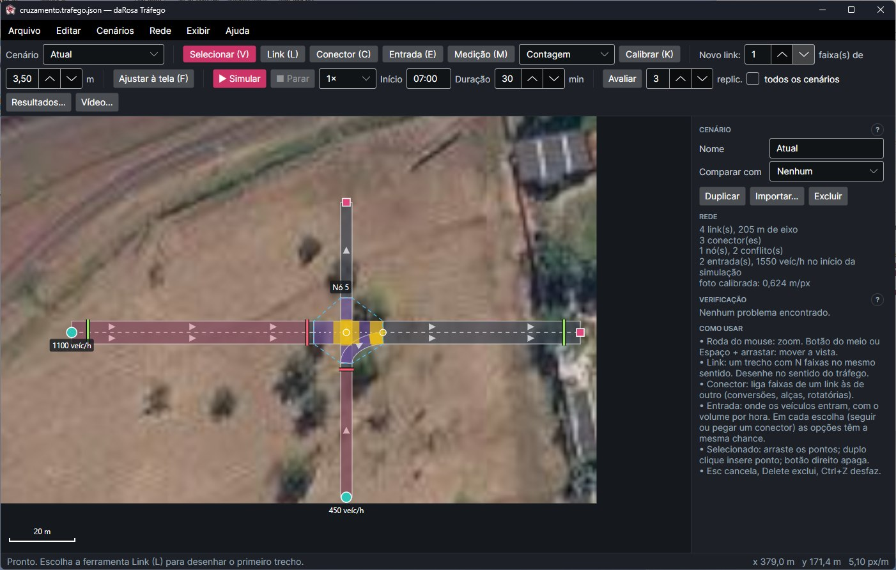
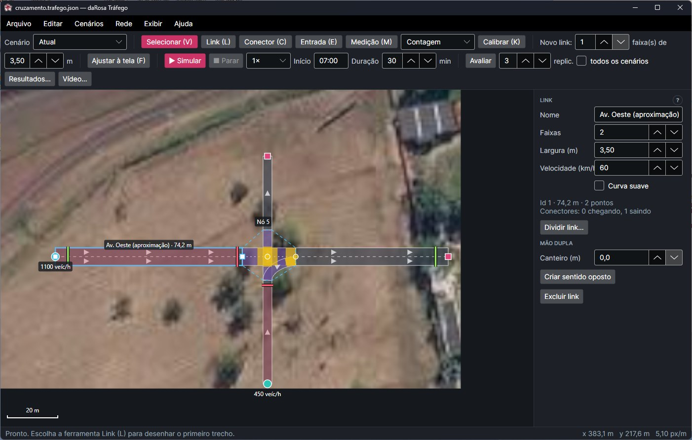
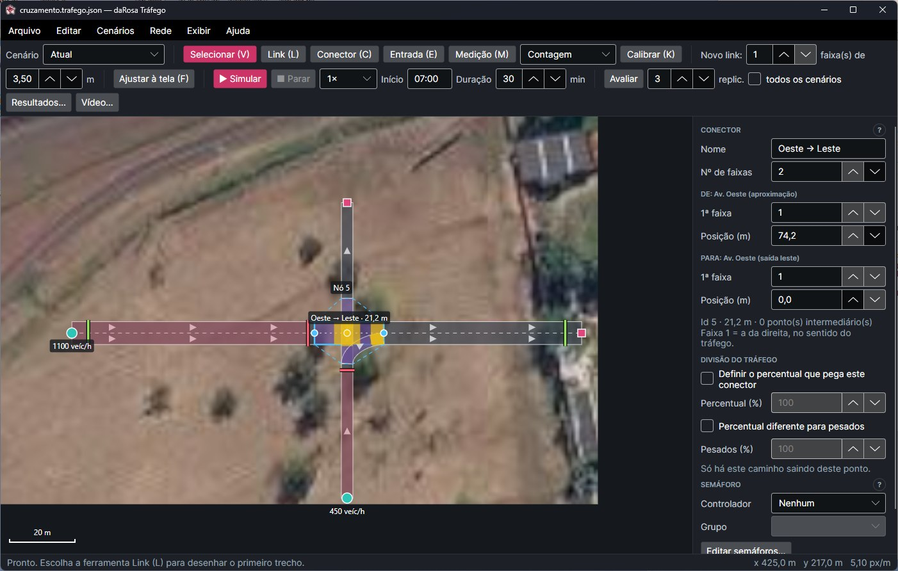
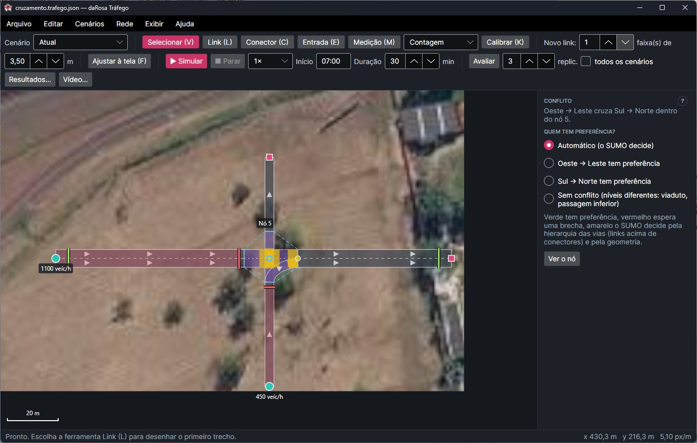
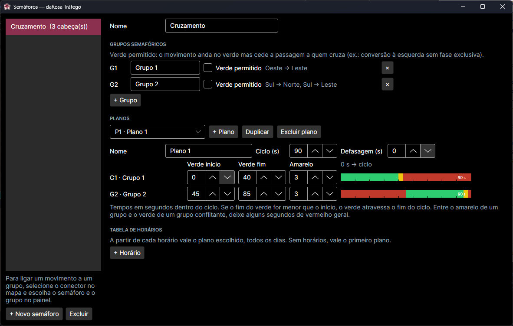
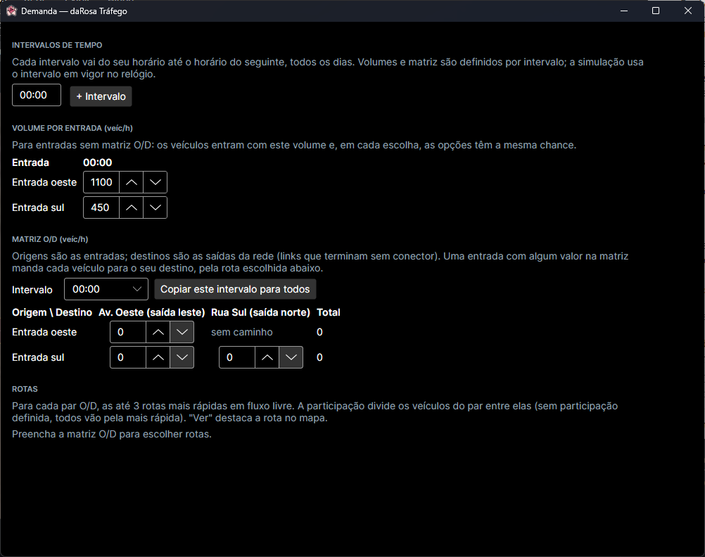
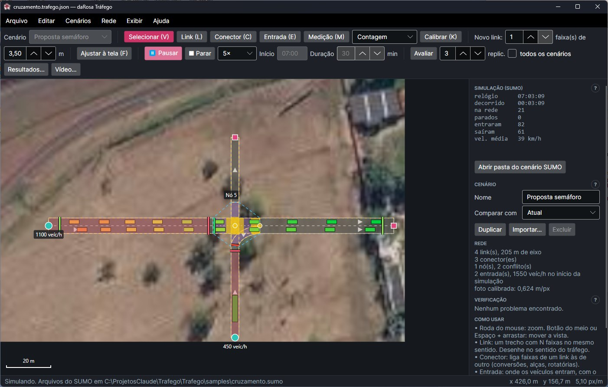
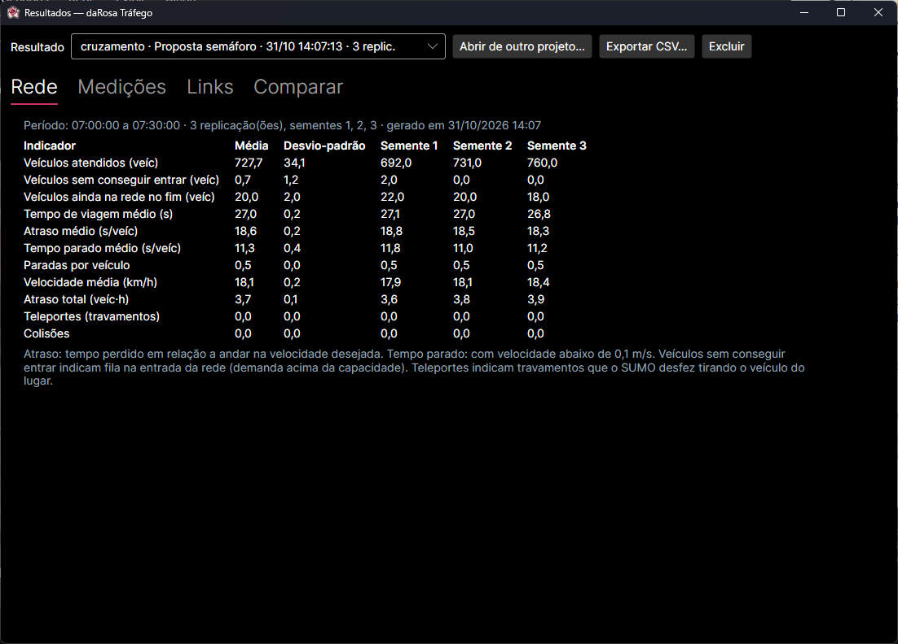
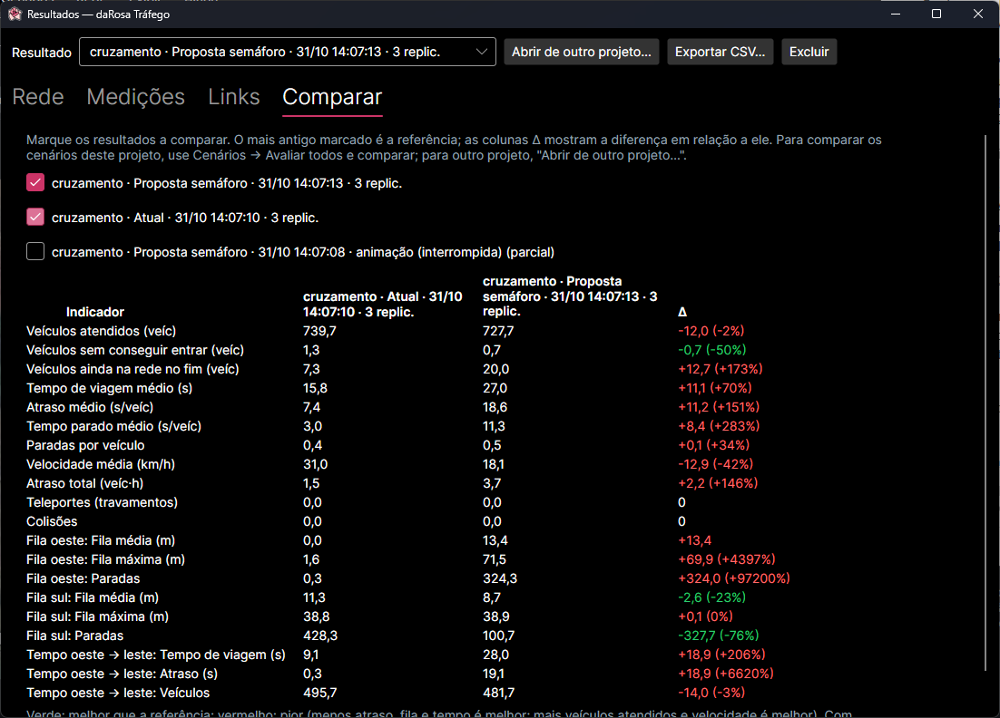

# Manual do daRosa Tráfego

O daRosa Tráfego é um editor de redes viárias no estilo do PTV Vissim. Você desenha as vias sobre uma foto aérea,
define a demanda e o controle (preferências e semáforos) e o programa simula o tráfego veículo a veículo
usando o **SUMO** como motor. No fim, mede e compara cenários — por exemplo, uma rotatória contra um DDI.

---

## Sumário

1. [Antes de começar](#1-antes-de-começar)
2. [Seu primeiro cenário em 10 minutos](#2-seu-primeiro-cenário-em-10-minutos)
3. [A tela](#3-a-tela)
4. [Foto aérea e calibração](#4-foto-aérea-e-calibração)
5. [Links: as vias](#5-links-as-vias)
6. [Conectores: as ligações entre vias](#6-conectores-as-ligações-entre-vias)
7. [Nós e conflitos: quem tem preferência](#7-nós-e-conflitos-quem-tem-preferência)
8. [Semáforos](#8-semáforos)
9. [Gerando tráfego: entradas e demanda](#9-gerando-tráfego-entradas-e-demanda)
10. [Simulando](#10-simulando)
11. [Medições](#11-medições)
12. [Avaliação e resultados](#12-avaliação-e-resultados)
13. [Comparando cenários](#13-comparando-cenários)
14. [Atalhos de teclado](#14-atalhos-de-teclado)
15. [Arquivos](#15-arquivos)
16. [Problemas comuns](#16-problemas-comuns)
17. [O que ainda não faz](#17-o-que-ainda-não-faz)

---

## 1. Antes de começar

**Precisa ter instalado:**

- **Windows 10 ou 11**.
- **Eclipse SUMO** (gratuito, [eclipse.dev/sumo](https://eclipse.dev/sumo/)), o motor que simula os veículos.
  O instalador do SUMO para Windows já cria a variável `SUMO_HOME`, que o programa usa para encontrá-lo.
  Sem o SUMO, o editor abre, mas não simula.
- **FFmpeg** (opcional), só para exportar vídeo: `winget install Gyan.FFmpeg`.

**Para abrir o programa**, use o atalho **daRosa Tráfego**. Ele abre com um projeto vazio. Na pasta
`samples`, ao lado do programa, há dois exemplos para abrir em **Arquivo → Abrir**:

- `exemplo.trafego.json`: só a foto de um viaduto com alças, já calibrada, para você desenhar (é a base do
  passo a passo da seção 2);
- `cruzamento.trafego.json`: um cruzamento pronto, com dois cenários (a situação atual, com preferência, e
  uma proposta com semáforo), entradas e medições. É o das figuras deste manual.

**Ajuda**: aperte **F1** a qualquer momento. A ajuda abre no navegador, já na seção do que você está usando
(a ferramenta ativa ou o objeto selecionado). Os botões **?** nos títulos do painel da direita fazem o mesmo.
No menu **Ajuda** ficam também os primeiros passos, os atalhos de teclado, os problemas comuns e este manual
em **PDF**, para imprimir. A busca, no alto do sumário, procura em todo o manual.

---

## 2. Seu primeiro cenário em 10 minutos

Um cruzamento de duas vias com semáforo. Abra o exemplo (Arquivo → Abrir → `samples/exemplo.trafego.json`) e use a área de pasto à direita da foto.

**Desenhar as vias**

1. Aperte **L** (ferramenta Link). Clique um ponto a oeste, depois dê **duplo clique** um pouco antes do
   centro do cruzamento. Isso cria a aproximação oeste, que vai **no sentido do tráfego** (de oeste para leste).
2. Do outro lado do cruzamento, crie a saída leste: clique logo depois do centro e dê duplo clique mais a leste.
3. Faça o mesmo para o sentido sul → norte: aproximação sul (de baixo até perto do centro) e saída norte
   (de logo acima do centro até em cima).

Deixe uns 10 a 20 m de espaço entre o fim das aproximações e o começo das saídas: é ali que ficam os conectores.

**Ligar as vias**

4. Aperte **C** (Conector). Clique perto do **fim** da aproximação oeste e depois perto do **início** da saída
   leste. Aparece um conector roxo atravessando o cruzamento.
5. Repita para sul → norte. Os dois conectores se cruzam: o programa cria um **nó** (contorno tracejado
   "Nó N") e marca o ponto de conflito em amarelo.

**Gerar tráfego**

6. Aperte **E** (Entrada). Clique no começo da aproximação oeste e no começo da aproximação sul.
   Cada clique cria uma entrada com 600 veíc/h. Ajuste o volume no painel da direita.

**Simular**

7. Clique em **▶ Simular**. Os carros aparecem, coloridos pela velocidade (verde andando, vermelho parado).
   O SUMO decide quem passa primeiro no cruzamento.
8. Clique em **■ Parar** para voltar a editar.

**Pôr um semáforo**

9. Menu **Rede → Semáforos…**. Já vem um semáforo com dois grupos e um plano de 90 s. Feche a janela.
10. Selecione o conector oeste → leste (ferramenta **V**, clique nele) e, no painel, escolha
    **Controlador: Semáforo** e **Grupo: G1**. Faça o mesmo com o sul → norte, escolhendo **G2**.
11. Simule de novo: agora uma fila espera no vermelho enquanto a outra passa.

**Medir e comparar**

12. Aperte **M** (Medição), escolha **Fila** na caixa ao lado e clique no fim da aproximação oeste.
13. Salve o projeto (**Ctrl+S**), clique em **Avaliar** e espere. Abre a janela de resultados.
14. Mude algo (por exemplo, o tempo de verde do G1 em Rede → Semáforos), clique em **Avaliar** de novo e
    veja a aba **Comparar**.

---

## 3. A tela

- **Barra de ferramentas** (em cima): ferramentas de edição, padrões para novos links, controles da
  simulação e da avaliação.
- **Mapa** (centro): a foto e a rede.
  - Roda do mouse: zoom no ponto do cursor.
  - Botão do meio, ou **Espaço + arrastar**, ou arrastar num lugar vazio: mover a vista.
  - **F**: enquadrar a foto inteira.
  - A barra de escala fica no canto inferior esquerdo.
- **Painel da direita**: propriedades do que está selecionado. Sem seleção, mostra o resumo da rede, a
  **verificação** (erros ✖ e avisos ⚠) e uma ajuda rápida. **Clique num aviso** para ver no mapa os objetos
  envolvidos: a vista se aproxima deles e eles ficam em **magenta**. Clique de novo no aviso (ou volte a editar
  o mapa) para tirar o destaque.
- **Barra de status** (embaixo): dicas da ferramenta atual, mensagens e a posição do cursor em metros.

**Ferramentas**

| Tecla | Ferramenta | Para que serve |
|---|---|---|
| V | Selecionar | selecionar, mover pontos, inserir e apagar pontos |
| L | Link | desenhar vias |
| C | Conector | ligar faixas de uma via a outra |
| E | Entrada | criar entradas de veículos |
| M | Medição | contagem, fila ou tempo de viagem |
| K | Calibrar | acertar a escala da foto |

**Esc** cancela o que está sendo feito; se não há nada, volta para Selecionar.

---

## 4. Foto aérea e calibração

1. **Arquivo → Abrir foto aérea…** e escolha uma imagem (PNG, JPG…). Um print do Google Maps ou do
   Google Earth com a **régua** de medição visível é o ideal.
2. A ferramenta **Calibrar** já fica ativa. Clique nas duas pontas de uma distância conhecida (a régua,
   uma faixa de pedestres, o comprimento de uma quadra…).
3. Digite a distância real em metros e clique em **Aplicar calibração**.

Tudo no programa é em metros. Se você recalibrar depois de desenhar, a rede é reescalada junto com a foto
e continua alinhada.

Dá para trabalhar sem foto: os links ficam sobre um fundo escuro, em metros.

---

## 5. Links: as vias

Um **link** é um trecho de via com uma ou mais faixas **no mesmo sentido**. Uma avenida de mão dupla são
dois links, um para cada sentido.

**Dividir um link em dois**: selecione o link, clique em **Dividir link…** no painel e depois no ponto do
link onde ele deve ser cortado (uma linha laranja mostra o ponto; Esc cancela). O link vira duas partes ligadas
por um conector curto com todas as faixas, e o tráfego segue como antes. Conectores e medições depois do ponto
passam para a segunda parte; a entrada fica na primeira; a matriz O/D e as rotas escolhidas são atualizadas.
Serve para mudar faixas ou velocidade só num trecho, ou para fazer um conector sair do meio do que era um link só.
Não dá para dividir a menos de 2 m das pontas.

**Mão dupla**: desenhe um sentido, selecione o link e clique em **Criar sentido oposto** (painel da direita).
O programa cria o outro sentido com a mesma forma, percorrida ao contrário, encostado do lado esquerdo
(trânsito pela direita), com as mesmas faixas e velocidade. Em **Canteiro (m)**, informe a distância entre as
bordas dos dois sentidos se houver canteiro central. Depois, ajuste os pontos onde a via real não for
paralela e mude faixas ou velocidade do outro sentido se forem diferentes. Os dois sentidos não formam conflito
entre si; nos cruzamentos, as conversões à esquerda cruzam o sentido oposto e o nó se forma sozinho.

**Desenhar**

- Ferramenta **L**. Clique para marcar o eixo da via, **no sentido do tráfego**. As setas mostram o sentido.
- **Duplo clique** ou **Enter** terminam o link; **botão direito** desfaz o último ponto; **Esc** cancela.
- Antes de desenhar, escolha na barra o número de faixas e a largura (**Novo link: N faixa(s) de X m**).

**Editar** (ferramenta V, link selecionado)

- Arraste os quadradinhos para mover pontos; arraste o corpo do link para movê-lo inteiro.
- **Duplo clique** sobre o link insere um ponto; **botão direito** sobre um ponto apaga.
- No painel: nome, número de faixas, largura, velocidade máxima (km/h) e **Curva suave** (o eixo passa a
  ser uma curva pelos pontos, bom para alças e rotatórias).

As faixas são numeradas a partir da **direita** (faixa 1 = a da direita, no sentido do tráfego).

---

## 6. Conectores: as ligações entre vias

O **conector** liga faixas de um link a faixas de outro. É com ele que se fazem conversões, alças,
entradas e saídas de rotatória e a continuação de uma via depois de um cruzamento.

**Criar**

- Ferramenta **C**. Clique na **faixa de origem** e depois na **faixa de destino**. A faixa sob o cursor
  fica destacada em azul.
- Perto do fim do link de origem, o conector gruda no fim; perto do início do destino, gruda no início.
- O conector também pode sair do **meio** de um link (uma faixa de saída, por exemplo) ou chegar no meio
  de outro (uma faixa de aceleração entrando na principal).

**Editar** (conector selecionado)

- No painel: número de faixas ligadas, a primeira faixa na origem e no destino e as posições.
- Arraste as **bolinhas** nas pontas para mover a saída ou a chegada ao longo do link.
- **Duplo clique** sobre o conector insere um ponto intermediário (para curvar); botão direito apaga;
  **Remover curvas** volta à curva automática.

**Dica**: num cruzamento, à moda do Vissim, as aproximações terminam antes do cruzamento e **cada movimento**
(seguir em frente, virar à direita, virar à esquerda) é um conector.

---

## 7. Nós e conflitos: quem tem preferência

O programa encontra sozinho onde os movimentos se encontram:

- **Cruzamento**: dois conectores se cruzam. Os conectores que se cruzam formam um **nó** (o contorno
  tracejado "Nó N"), que vira uma interseção no SUMO.
- **Convergência**: um conector entra no fluxo principal de um link, ou dois conectores chegam nas mesmas faixas.
- **Link cruzando link** (ou conector) no meio do caminho: aparece em **laranja**, com um aviso — veja abaixo.

**Áreas de conflito**, como no Vissim:

| Cor | Significado |
|---|---|
| Amarelo | o SUMO decide (links têm preferência sobre conectores; depois, a geometria) |
| Verde / vermelho | verde tem preferência, vermelho espera uma brecha |
| Cinza | sem conflito (níveis diferentes) |
| Laranja | link cruzando no meio: não simulado como interseção |

**Definir a preferência**: clique no **marcador** (bolinha) do conflito e escolha no painel:
*Automático*, *A tem preferência*, *B tem preferência* ou *Sem conflito (níveis diferentes)* — esta última para
viadutos e passagens inferiores.

**Controle do nó**: clique no rótulo **"Nó N"** e escolha:

- **Via preferencial** (padrão): vale o que foi definido nos conflitos;
- **Preferência de quem vem pela direita** (CTB, art. 29, cruzamento sem sinalização);
- **Parada obrigatória em todas** as aproximações.

**Link cruzando link (laranja)**: se for um viaduto, marque *níveis diferentes*. Se for um cruzamento no mesmo
nível, termine os links antes do cruzamento e ligue os movimentos por conectores.

---

## 8. Semáforos

**Menu Rede → Semáforos…** abre o editor de controladores (tempo fixo).

- **Grupos semafóricos**: movimentos que abrem juntos.
  - Marque **Verde permitido** quando o movimento anda no verde, mas cede a passagem a quem cruza
    (por exemplo, uma conversão à esquerda sem fase exclusiva).
- **Planos**: ciclo, defasagem e, para cada grupo, início do verde, fim do verde e amarelo, em segundos
  dentro do ciclo. O diagrama ao lado mostra verde, amarelo e vermelho ao longo do ciclo.
  - Se o fim do verde for menor que o início, o verde atravessa o fim do ciclo.
  - Deixe alguns segundos de **vermelho geral** entre o amarelo de um grupo e o verde de um grupo conflitante.
  - **Duplicar** copia um plano (útil para fazer o plano de pico a partir do normal).
- **Tabela de horários**: a partir de cada horário vale um plano, todos os dias. Sem horários, vale o primeiro plano.

**Ligar um movimento a um grupo** (a "cabeça semafórica"): selecione o conector no mapa e, no painel, escolha
**Controlador** e **Grupo**. A barra no começo do conector fica cinza na edição e muda de cor na simulação.

Movimentos **sem** cabeça semafórica num nó com semáforo passam sem cor, pelas regras de preferência —
é como se faz uma conversão livre à direita.

A verificação **avisa** quando dois grupos cujos movimentos se cruzam ficam verdes ao mesmo tempo.

---

## 9. Gerando tráfego: entradas e demanda

**Sem entrada não há tráfego.** Os veículos nascem nas entradas.

**Entrada de veículos** (ferramenta **E**): clique no começo do link onde os veículos entram na rede. No painel:

- **Volume (veíc/h)**: quantos veículos por hora;
- **Pesados (%)**: a parte que é caminhão (mais longo, mais lento para arrancar).

As chegadas são **aleatórias** (processo de Poisson), como na vida real: às vezes vêm vários juntos, às vezes
ninguém por um tempo.

**Para onde os veículos vão?** Há dois jeitos:

1. **Sem matriz** (o padrão): em cada ponto de escolha (seguir no link ou pegar um conector), os veículos se
   dividem. Sem nada definido, as opções têm a mesma chance (num cruzamento com três saídas, um terço cada).
   Para usar o que você sabe do local, defina o **percentual nos conectores** (veja abaixo).
2. **Com matriz O/D** (menu **Rede → Demanda…**): você diz quantos veículos por hora vão de cada entrada até
   cada saída da rede.

**Percentual no conector** (divisão do tráfego, como a "decisão de rota" do Vissim): selecione o conector e,
no painel, marque **Definir o percentual que pega este conector** e digite o valor. Exemplo: numa saída de
rodovia por onde passam 60% dos veículos, ponha 60 no conector da saída; os 40% restantes seguem na rodovia.

- O que sobra vai, em partes iguais, para as opções sem percentual (seguir no link e os outros conectores).
  Num cruzamento, dá para pôr só as conversões (ex.: 20% à esquerda, 15% à direita) e o resto segue em frente.
- O painel mostra como fica a divisão naquele ponto, e o mapa mostra o percentual sobre o conector.
- **Pesados diferentes dos leves**: marque **Percentual diferente para pesados** e digite o valor. Exemplo: numa
  saída que 70% dos carros pegam, mas só 10% dos caminhões, ponha 70 em Percentual e 10 em Pesados. Sem essa
  opção, os caminhões seguem o mesmo percentual dos carros. O mapa mostra "70% · pes. 10%".
- Se os percentuais de um ponto somarem mais de 100% (ou menos, sem outra opção), a verificação avisa e eles
  são ajustados para somar 100%.
- Vale para entradas **sem** matriz O/D; as entradas com matriz seguem as rotas da matriz.

**Rede → Demanda…**

- **Intervalos de tempo**: por exemplo 07:00, 07:15, 07:30… Cada um vale até o seguinte, todos os dias.
  Servem para simular a variação ao longo do pico.
- **Volume por entrada**: o volume de cada entrada em cada intervalo (para entradas sem matriz).
- **Matriz O/D**: origens são as entradas; destinos são as **saídas** — links que terminam sem conector,
  marcados no mapa com um **quadrado rosa**. Se uma entrada não alcança uma saída, aparece "sem caminho".
  Uma entrada com algum valor na matriz passa a usá-la (o volume do painel deixa de valer).
- **Rotas**: para cada par origem → destino, aparecem até 3 caminhos, do mais rápido ao mais lento. Defina a
  **participação** (%) de cada um. Sem participação, todos vão pelo mais rápido. **Ver** destaca a rota em
  laranja no mapa.

---

## 10. Simulando

Na barra de ferramentas:

- **Início**: horário do dia em que a simulação começa (por exemplo 07:00). Ele decide o plano semafórico e
  o intervalo de demanda em vigor.
- **Duração**: quantos minutos simular.
- **▶ Simular** / **⏸ Pausar** / **▶ Continuar** / **■ Parar**.
- **Velocidade**: 1×, 2×, 5×, 10× ou **Máx.** (o mais rápido que o computador conseguir).

Durante a simulação, a rede fica **só para leitura**: dá para mover a vista e dar zoom, mas não editar.
O painel mostra o relógio, os veículos na rede, os parados, quantos entraram e saíram e a velocidade média.

Logo abaixo vêm os **avisos do SUMO** sobre a rede gerada. Os ids internos do SUMO (como `L127_0_1` ou `J140`)
aparecem com os nomes do editor ("faixa 2 de Link 127", "Nó 140"), e os avisos mais comuns vêm explicados em
português. Como na verificação, **clique no aviso** para destacar no mapa o link, a faixa, o conector ou o nó
de que ele fala. Os mais frequentes:

| Aviso | O que significa |
|---|---|
| A faixa N de um link não recebe nenhum conector | nenhum conector chega nessa faixa; os veículos só entram nela trocando de faixa depois. Às vezes é intencional (uma faixa que começa ali) |
| Curva muito fechada no início/fim de um conector | o conector faz um ângulo forte com a via; os veículos reduzem muito ali. Suavize a curva |
| Curva fechada na passagem A → B | a velocidade cai na conversão. Normal em alças e conversões |
| Conversões à esquerda que se cruzam | dois conectores se cruzam de um jeito que o SUMO não resolve bem; afaste-os |

**Cores dos veículos**: vermelho parado → amarelo → verde a 60 km/h ou mais. Caminhões são um pouco mais escuros.

Ao clicar em **Parar**, os resultados desta simulação são salvos (veja a seção 12).

**Vídeo do teste**: com a simulação parada, clique em **Vídeo…** (barra de ferramentas) ou em
**Arquivo → Exportar vídeo da simulação…**. O programa roda o teste de novo (mesma semente, mesmo resultado),
sem tempo real, e grava um **MP4** com a área que está **na tela** — ajuste o zoom antes. Escolha:

- **Começar aos** e **Duração**: o trecho da simulação (em minutos);
- **Velocidade**: quantas vezes mais rápido que o real (10× = 10 minutos de simulação em 1 minuto de vídeo);
- **Resolução**: 1920 × 1080, 1280 × 720 ou o tamanho da tela.

O vídeo mostra a foto, a rede, os veículos e os semáforos (sem os elementos de edição), com o relógio e um resumo
da simulação no canto. No fim, **Abrir vídeo** ou **Abrir pasta**. Precisa do **FFmpeg** instalado
(`winget install Gyan.FFmpeg`).

O botão **Abrir pasta do cenário SUMO** mostra os arquivos gerados para o SUMO. O `cenario.sumocfg` abre no
**sumo-gui** do próprio SUMO, para conferir ou estudar.

---

## 11. Medições

Ferramenta **M**. Escolha o tipo na caixa ao lado do botão e clique no link:

| Tipo | Onde clicar | O que mede |
|---|---|---|
| **Contagem** | no ponto da via | volume (veíc/h) e velocidade de todas as faixas |
| **Fila** | na linha de retenção (gruda no fim do link) | fila média e máxima (m), na faixa mais carregada, e paradas |
| **Tempo de viagem** | no início e depois no fim do trecho | tempo de viagem e atraso de quem passa pelos dois pontos |

No mapa, as medições são barras atravessando a via: azul (contagem), vermelha com a área medida
(fila) e verde (tempo de viagem, no início e no fim). Arraste as barras para mover. No painel: nome e,
para a fila, até quantos metros a montante medir (padrão 150 m).

**Dê nomes claros** (ex.: "Fila aproximação norte"): na comparação de cenários, medições com o mesmo nome
se comparam entre si.

---

## 12. Avaliação e resultados

**Avaliar** (barra de ferramentas) roda o período inteiro várias vezes, cada uma com uma **semente**
aleatória diferente, sem animação e em paralelo. Isso é importante: como as chegadas são aleatórias, uma
rodada só pode enganar. O padrão são 3 replicações; para conclusões mais firmes, use 5 a 10.
Clicar de novo durante a avaliação cancela.

**Resultados…** abre a janela de resultados, com quatro abas:

- **Rede**: veículos atendidos, veículos que não conseguiram entrar (fila na entrada da rede: a demanda passou
  da capacidade), veículos ainda na rede, tempo de viagem médio, **atraso médio**, tempo parado, paradas,
  velocidade média, atraso total, teleportes e colisões. Mostra a média, o desvio-padrão e cada semente.
- **Medições**: cada medição por intervalo (padrão 15 min) e no período todo.
- **Links**: volume, velocidade, atraso e densidade de cada link. **Colorir o mapa pela velocidade** pinta as
  vias (verde na velocidade máxima, amarelo pela metade, vermelho parado) — ótimo para achar gargalos.
- **Comparar**: veja a próxima seção.

**Exportar CSV…** gera uma planilha (ponto e vírgula e vírgula decimal, abre direto no Excel).

Os resultados ficam guardados na pasta `<projeto>.resultados/`, ao lado do arquivo do projeto.

**Como ler**:

- **Atraso** é o tempo perdido em relação a andar livre na velocidade desejada.
- **Teleportes** indicam travamentos que o SUMO desfez tirando o veículo do lugar. Se aparecerem, há algo
  errado na rede (faixa sem saída, conflito mal resolvido) ou demanda muito acima da capacidade.
- **Colisões** devem ser zero.

---

## 13. Comparando cenários

Um projeto pode ter vários **cenários**: a situação atual e uma ou mais propostas, no mesmo arquivo. Cada
cenário tem a sua própria rede, nós, semáforos, **demanda** (entradas, matriz O/D, rotas) e medições. A foto,
a calibração e o período simulado (início, duração, replicações) são do projeto, iguais para todos.

O cenário em edição aparece no seletor **Cenário**, no começo da barra de ferramentas. Com nada selecionado
no mapa, o painel da direita mostra o nome dele e os botões para gerenciar os cenários (também no menu
**Cenários**).

**Para criar uma proposta a partir da situação atual:**

1. Desenhe a situação atual (o primeiro cenário se chama "Atual").
2. Clique em **Duplicar**. A cópia já fica em edição. Dê um nome a ela no painel (por exemplo "Proposta
   rotatória").
3. Altere só o que muda. O **contorno amarelo tracejado** mostra a rede do outro cenário por cima, para você
   ver o que mudou. Escolha qual cenário aparece em **Comparar com** ("Nenhum" desliga).
4. Ajuste a demanda da proposta em **Rede → Demanda**, se as vias que geram tráfego mudaram.

**Para juntar projetos que você já tem em arquivos separados:** abra um deles e use **Importar…** (ou
**Cenários → Importar de outro projeto…**) para trazer o outro. Pode escolher vários arquivos de uma vez.

- Cada cenário importado leva o nome do arquivo, ou "arquivo · cenário" se o arquivo tiver vários cenários.
- Se os dois projetos usam a **mesma foto** (mesmo nome de arquivo), a rede importada cai no lugar certo,
  mesmo que as calibrações sejam diferentes.
- Se o projeto aberto ainda não tem foto, ele passa a usar a do arquivo importado.
- Se as fotos são diferentes, a barra de status avisa: confira se a rede ficou no lugar.
- Num projeto novo e vazio, o primeiro arquivo importado toma o lugar do cenário vazio. Assim dá para fazer
  **Novo → Importar** com todos os arquivos de uma vez.

**Para comparar os resultados:** marque **todos os cenários** ao lado de **Avaliar** (o quadrinho aparece
quando há mais de um cenário), ou use **Cenários → Avaliar todos e comparar**. Cada cenário roda com as mesmas
sementes, um depois do outro, e a janela de resultados abre já na aba **Comparar**. O primeiro cenário é a
referência. As colunas **Δ** mostram a diferença e a porcentagem, em **verde** quando melhora e **vermelho**
quando piora. As medições se comparam pelo **nome**: dê o mesmo nome à medição equivalente em cada cenário
(quem duplica já sai com os mesmos nomes).

Na aba **Comparar** você também pode marcar quaisquer resultados, inclusive de outros projetos (**Abrir de
outro projeto…**). O mais antigo marcado é a referência.

Com poucas replicações, diferenças menores que o desvio-padrão podem ser só acaso.

---

## 14. Atalhos de teclado

| Atalho | Ação |
|---|---|
| F1 | ajuda sobre o que está em uso |
| V, L, C, E, M, K | ferramentas (Selecionar, Link, Conector, Entrada, Medição, Calibrar) |
| F | enquadrar a foto |
| Esc | cancelar / voltar para Selecionar / tirar a seleção |
| Delete | excluir o selecionado |
| Enter | terminar o link em desenho |
| Espaço + arrastar | mover a vista |
| Ctrl+Z / Ctrl+Y | desfazer / refazer |
| Ctrl+N / Ctrl+O | projeto novo / abrir |
| Ctrl+S / Ctrl+Shift+S | salvar / salvar como |

---

## 15. Arquivos

Para um projeto salvo como `cenario.trafego.json`:

| Arquivo ou pasta | Conteúdo |
|---|---|
| `cenario.trafego.json` | o projeto: os cenários (cada um com rede, semáforos, demanda e medições) e a configuração da simulação. A foto é guardada como caminho relativo — mantenha a imagem junto. Arquivos de versões anteriores abrem normalmente, com a rede como cenário "Atual" |
| `cenario.sumo/` | arquivos gerados para o SUMO (rede, rotas, semáforos, detectores, configuração) e as saídas das simulações |
| `cenario.resultados/` | resultados das avaliações (`.resultado.json`) |

Sem salvar, o programa usa a pasta temporária do Windows (`%TEMP%\trafego`).

---

## 16. Problemas comuns

**"SUMO não encontrado"**: instale o Eclipse SUMO e confira se a variável `SUMO_HOME` existe. Depois de
instalar, feche e abra o terminal e recompile o programa.

**Nenhum carro aparece**: falta uma **entrada** (ferramenta E) ou o volume está zero.

**A divisão numa saída ou num cruzamento não bate com o que se vê no local**: defina o percentual nos
conectores (seção 9).

**Os carros somem no fim de uma via**: é uma saída da rede (quadrado rosa). Para continuar, ligue o fim dela
a outra via com um conector.

**Os carros ficam parados num ponto / aparecem teleportes**:

- uma faixa sem continuação: o veículo precisa mudar de faixa e não consegue. Ligue as faixas que faltam
  com conectores (por exemplo, um conector de 2 faixas em vez de 1);
- um conflito em que todos esperam: defina quem tem preferência;
- um semáforo que nunca abre para um grupo: confira o plano.

**Aparece um "nó" onde não deveria** (por exemplo, num viaduto): clique no marcador do conflito e escolha
*Sem conflito (níveis diferentes)*.

**Um link em laranja com aviso de cruzamento**: veja a seção 7.

**A verificação (painel da direita, sem nada selecionado)** lista o que precisa ser corrigido antes de simular.

---

## 17. O que ainda não faz

- Link que cruza outro link no meio do caminho não vira interseção: use conectores no cruzamento.
- Semáforos só de tempo fixo (sem atuação por detectores) e só em conectores.
- Pedestres, ciclistas e transporte coletivo.
- Escolha dinâmica de rota por congestionamento (as rotas são fixas, com participação definida).
- Avaliação por nó (atraso e nível de serviço por movimento): por enquanto, use uma medição de tempo de
  viagem por movimento.
- A fila é medida só dentro do trecho do link que termina no ponto.
